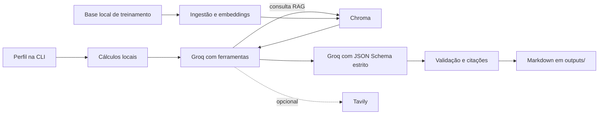

# AI Fitness Coach

O AI Fitness Coach gera um plano de treinamento de força de três semanas a partir do perfil do usuário. A aplicação combina um LLM hospedado no Groq, um ciclo de ferramenta RAG orquestrado pelo LangGraph, cálculos determinísticos locais, uma base de conhecimento sobre treinamento com Chroma e pesquisa opcional na web com Tavily.

Este projeto é um protótipo para portfólio de engenharia. Os planos gerados não são aconselhamento médico, e as estimativas de calorias são aproximadas.

## Funcionalidades

- Orquestração com LangGraph: uma chamada seleciona ferramentas para buscar evidências no RAG e outra gera o plano com JSON Schema estrito.
- Validação do perfil e estimativas determinísticas de IMC e gasto energético.
- Geração aumentada por recuperação (RAG) sobre uma base local de textos de treinamento, com embeddings do Hugging Face e Chroma.
- Citações por exercício vinculadas a trechos realmente retornados pela ferramenta RAG interna.
- Pesquisa opcional com Tavily para informações gerais atualizadas sobre treinamento; desativada no fluxo padrão para preservar sua cota gratuita.
- Schema de saída que exige três semanas, progressão descrita em cada semana, o número solicitado de sessões e três exercícios por sessão. Para frequência de quatro dias, aplica a ordem Upper A, Lower A, Upper B e Lower B.
- Referências de exercícios priorizam trechos específicos retornados pelo RAG quando disponíveis; dicas de execução são curtas e a progressão usa repetições/carga condicionadas à técnica, sem inventar pesos.
- Campos obrigatórios de aviso de segurança, condições para interromper o treino e orientação para buscar ajuda profissional.
- Interface de linha de comando e notebook mantido para experimentação.
- Imagem Docker de execução e imagem isolada para testes com pytest.
- Workflow do GitHub Actions para testes e verificação da sintaxe dos notebooks.
- Logs JSON com duração da geração e uso de tokens informado pelo provedor, quando disponível.

## Arquitetura



Consulte a [documentação da arquitetura](docs/architecture.md) para conhecer as responsabilidades dos módulos e os fluxos de execução, e as [decisões de arquitetura](docs/decisions.md) para consultar os ADRs.
O protocolo e os resultados de referência do benchmark de recuperação estão em [avaliação do RAG](docs/evaluation.md).
Use o [roteiro de revisão dos planos](evaluation/plan_review_template.md) para registrar avaliações qualitativas de fundamentação, precisão das citações, comunicação de segurança, consistência e legibilidade.

## Requisitos

Recomendamos Docker Engine com o plugin Docker Compose. A imagem de execução usa Python 3.12 e instala a versão de PyTorch para CPU. Também é possível executar a aplicação em um ambiente local com Python 3.12 após instalar `requirements.txt`; o pytest está declarado separadamente em `requirements-test.txt`.

## Configuração

Copie `.env.example` para `.env` e informe uma chave Groq. A chave Tavily só é necessária se você habilitar a busca web:

```dotenv
GROQ_API_KEY=sua_chave_groq
TAVILY_API_KEY=sua_chave_tavily
```

As configurações opcionais são `TAVILY_API_KEY` (necessária somente com `--web-search`), `CHROMA_PERSIST_DIRECTORY`, `EMBEDDING_MODEL_NAME` e `GROQ_MODEL_NAME`. Mantenha `.env` privado: ele é excluído do Git e do contexto de build do Docker.

O modelo padrão é `openai/gpt-oss-20b`, substituto recomendado pelo Groq após a desativação de `llama-3.1-8b-instant`. Para evitar cobranças, use a conta no Free Plan e confira o nível e os limites de uso no painel antes de gerar planos. Os limites e modelos disponíveis podem mudar; o plano Developer é pago conforme o uso. Consulte a [política de descontinuação de modelos](https://console.groq.com/docs/deprecations) e as [informações oficiais de faturamento](https://console.groq.com/docs/billing-faqs).

## Compilar e executar com Docker Compose

Compile a imagem de execução:

```bash
docker compose build fitness-coach
```

Ingestione ou atualize a base de conhecimento. Na primeira execução, o modelo de embeddings será baixado e o processo poderá levar alguns minutos:

```bash
docker compose run --rm --entrypoint python fitness-coach -m app.rag.ingestion
```

Execute o benchmark determinístico de recuperação, que usa um conjunto pequeno de evidências revisadas manualmente:

```bash
docker compose run --rm --entrypoint python fitness-coach -m app.rag.evaluation
```

O benchmark informa hit-rate@k, mean reciprocal rank (MRR) e latência média de recuperação na máquina atual. Essas métricas verificam trechos de evidência específicos; elas não demonstram fidelidade semântica dos planos gerados.

Gere um plano:

```bash
docker compose run --rm --entrypoint python fitness-coach \
  -m app.main \
  --age 28 \
  --weight-kg 70 \
  --height-cm 170 \
  --gender female \
  --frequency 4 \
  --goal hipertrofia
```

O plano será salvo no host em `outputs/plano_de_treino_final.md`. O Compose mantém os dados do Chroma e os arquivos do modelo Hugging Face em volumes nomeados.

O caminho padrão calcula métricas localmente e não chama Tavily. O agente consulta a base RAG e pede ao LLM um plano conciso com três exercícios por sessão. Uma geração usa no máximo um ciclo RAG por padrão; o limite de recursão protege contra loops que consumiriam chamadas adicionais. Para permitir pesquisa externa, use a flag `--web-search`; ela adiciona o Tavily e pode consumir a cota gratuita separada desse serviço.

Após a consulta RAG, o GPT-OSS gera a resposta final com Structured Outputs e um schema estrito, com orçamento de até 4096 tokens de conclusão. A aplicação converte os campos numerados para sua estrutura interna, valida contagens, limites e citações e só então renderiza o Markdown. Essa validação estrutural não comprova segurança médica nem correção factual; revise os planos antes de utilizá-los.
Cada citação de exercício precisa apontar para um ID estável `KB-...` presente nas mensagens reais da ferramenta RAG. Se os resultados incluírem um trecho que nomeia o exercício, a validação exige esse trecho. Essa checagem é lexical e limitada: não prova que toda afirmação seja sustentada semanticamente nem que o plano seja adequado para uma pessoa específica.

Os logs da geração são emitidos como linhas JSON. Incluem duração e número de sessões e, quando os metadados da resposta do provedor fornecem essa informação, o uso de tokens. Prompts, valores do perfil do usuário, trechos recuperados e credenciais não são registrados. A aplicação não estima o custo monetário.
Para o GPT-OSS, o cliente usa esforço de raciocínio baixo e não inclui o campo separado de raciocínio na resposta. Repetições automáticas do SDK estão desativadas; se o Groq retornar limite de taxa (`429`), aguarde o período indicado antes de iniciar outra geração.

## Executar localmente sem Docker

```bash
python -m venv .venv
source .venv/bin/activate  # Windows: .\.venv\Scripts\activate
python -m pip install -r requirements.txt
cp .env.example .env      # depois, adicione a chave Groq; Tavily é opcional
python -m app.rag.ingestion
python -m app.main --age 28 --weight-kg 70 --height-cm 170 \
  --gender female --frequency 4 --goal hipertrofia
```

A CLI exige uma chave Groq e uma coleção Chroma já alimentada. Para usar a busca opcional, informe também uma chave Tavily. O download do modelo de embeddings requer acesso à rede.

Para habilitar Tavily em uma execução específica, adicione `--web-search` ao comando. Sem essa flag, a aplicação não cria nem chama o cliente Tavily.

## Executar os testes

Os testes usam substitutos (mocks/fakes) nas fronteiras com modelos e ferramentas e não chamam o Groq ou Tavily nem baixam um modelo de embeddings.

```bash
docker build --target test -t ai-fitness-coach:test .
```

Ou, em um ambiente local com as dependências de teste instaladas:

```bash
python -m pip install -r requirements-test.txt
python -m pytest -q
```

A mesma suíte determinística e a verificação da sintaxe dos notebooks são executadas pelo GitHub Actions em pushes e pull requests.

## Notebooks

- `02_Agente_Treinador_Fitness.ipynb` é o único notebook mantido; ele usa os mesmos módulos da aplicação como material de experimentação.

A CLI é o ponto de entrada reproduzível. A base vetorial não é distribuída no repositório: ela é criada localmente pela etapa de ingestão a partir de `dados/conhecimento_fitness.txt`.

## Limitações conhecidas

- O benchmark de cinco consultas mede atualmente a recuperação de trechos específicos; relevância semântica e fidelidade das respostas ainda não foram medidas. O top-k permanece em 3 e não há limiar de similaridade.
- A proveniência das citações é validada, mas a relação de implicação entre a evidência e cada afirmação ainda não é avaliada automaticamente.
- Não há novas tentativas automáticas de chamadas à API, acompanhamento de custos por requisição nem rastros persistentes do agente.
- Os cálculos de condicionamento físico e gasto energético são heurísticas simplificadas e não devem ser usados como orientação clínica ou nutricional.
- A validação da saída verifica a estrutura e a presença de campos de segurança, mas não avalia semanticamente a segurança dos exercícios ou sua adequação médica.
- Registros existentes no Chroma com metadados de origem antigos podem coexistir com registros criados pela nova rotina de ingestão.

## Próximas melhorias

- Ampliar o conjunto de evidências do benchmark e revisar os resultados da recuperação com embeddings reais antes de ajustar o chunking ou o top-k.
- Aplicar o roteiro de revisão a várias gerações reais e sintetizar as observações antes de ajustar prompts ou recuperação.
- Adicionar métricas de latência e uso de tokens e avaliar a fidelidade das respostas em relação às evidências recuperadas.
- Fixar as versões das dependências de execução e atualizá-las periodicamente.
