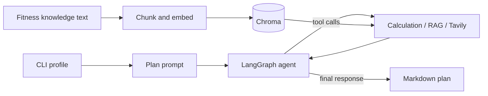

# AI Fitness Coach

AI Fitness Coach generates a three-week strength-training plan from a user's profile. It combines a Groq-hosted LLM, a LangGraph tool loop, deterministic profile calculations, a Chroma-backed fitness knowledge base, and Tavily web search.

The project is an engineering portfolio prototype. The generated plan is not medical advice, and the calorie figures are rough estimates.

## Features

- LangGraph model/tool cycle with a bounded recursion limit.
- Profile validation and deterministic BMI and energy estimates.
- Retrieval-augmented generation over the local fitness knowledge text, using Hugging Face embeddings and Chroma.
- Tavily search for current general fitness information.
- Strict JSON output contract for exactly three weeks and the requested number of sessions, validated before deterministic Markdown rendering.
- Required safety disclaimer, stop conditions, and referral guidance fields in each generated plan.
- CLI entry point and notebook retained for experimentation.
- Docker runtime and isolated pytest image target.

## Architecture



See [architecture](docs/architecture.md) for module responsibilities and execution flows, and [architecture decisions](docs/decisions.md) for the ADRs.
The retrieval benchmark protocol and observed baseline are documented in [retrieval evaluation](docs/evaluation.md).

## Requirements

Docker Engine with the Docker Compose plugin is the recommended setup. The runtime image uses Python 3.12 and installs the CPU-only PyTorch wheel. A local Python 3.12 environment can also run the app after installing `requirements.txt`; pytest is declared separately in `requirements-test.txt`.

## Configuration

Copy `.env.example` to `.env` and provide API keys:

```dotenv
GROQ_API_KEY=your_groq_key
TAVILY_API_KEY=your_tavily_key
```

The optional settings are `CHROMA_PERSIST_DIRECTORY`, `EMBEDDING_MODEL_NAME`, and `GROQ_MODEL_NAME`. Keep `.env` private; it is excluded from Git and the Docker build context.

## Build and run with Docker Compose

Build the runtime image:

```bash
docker compose build fitness-coach
```

Ingest or refresh the knowledge base. The first run downloads the embedding model and may take several minutes:

```bash
docker compose run --rm --entrypoint python fitness-coach -m app.rag.ingestion
```

Run the deterministic retrieval benchmark against a small, manually reviewed evidence set:

```bash
docker compose run --rm --entrypoint python fitness-coach -m app.rag.evaluation
```

It reports hit-rate@k, mean reciprocal rank (MRR), and mean retrieval latency for the current machine. These metrics check exact evidence snippets and do not establish semantic faithfulness of generated plans.

Generate a plan:

```bash
docker compose run --rm --entrypoint python fitness-coach \
  -m app.main \
  --age 28 \
  --weight-kg 70 \
  --height-cm 170 \
  --gender female \
  --frequency 4 \
  --goal hipertrofia
```

The plan is written to `outputs/plano_de_treino_final.md` on the host. Compose persists Chroma data and Hugging Face model files in named volumes.

The LLM is prompted to return structured JSON. The application rejects malformed or incomplete output rather than saving a partial plan, then renders valid content as Markdown. This structural validation does not establish medical safety or factual correctness; review generated plans before use.

## Run locally without Docker

```bash
python -m venv .venv
source .venv/bin/activate  # Windows: .\.venv\Scripts\activate
python -m pip install -r requirements.txt
cp .env.example .env      # then add valid API keys
python -m app.rag.ingestion
python -m app.main --age 28 --weight-kg 70 --height-cm 170 \
  --gender female --frequency 4 --goal hipertrofia
```

The CLI requires both Groq and Tavily credentials and an ingested Chroma collection. Model and embedding downloads require network access.

## Run tests

Tests use doubles for model/tool boundaries and do not call Groq, Tavily, or download an embedding model.

```bash
docker build --target test -t ai-fitness-coach:test .
```

Or in a local environment with test dependencies installed:

```bash
python -m pip install -r requirements-test.txt
python -m pytest -q
```

## Notebooks

- `01_RAG_Preparacao.ipynb` documents the original RAG experiment.
- `02_Agente_Treinador_Fitness.ipynb` remains an experimental agent entry point and delegates shared runtime setup to `app/`.

The CLI is the reproducible application entry point; notebooks are for exploration.

## Known limitations

- The five-query benchmark currently measures exact evidence recall; semantic relevance and answer faithfulness remain unmeasured. Top-k remains 3 and no similarity threshold is applied.
- Retrieved passages are not cited in the final generated plan.
- API retries, request-level cost tracking, and persistent agent traces are not implemented.
- Fitness and energy calculations are simplified heuristics and should not be used as clinical or dietary guidance.
- Output validation checks required structure and safety fields, but does not semantically verify exercise safety or medical suitability.
- Existing Chroma records with legacy source metadata may remain alongside records created by the new ingestion routine.

## Future work

- Expand the retrieval evidence set and review its real embedding-based baseline before tuning chunking or top-k.
- Add a reviewed semantic safety and faithfulness evaluation rubric for generated plans.
- Add latency/token usage telemetry and evaluate response faithfulness against retrieved evidence.
- Pin and periodically update runtime dependency versions.
