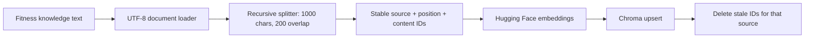
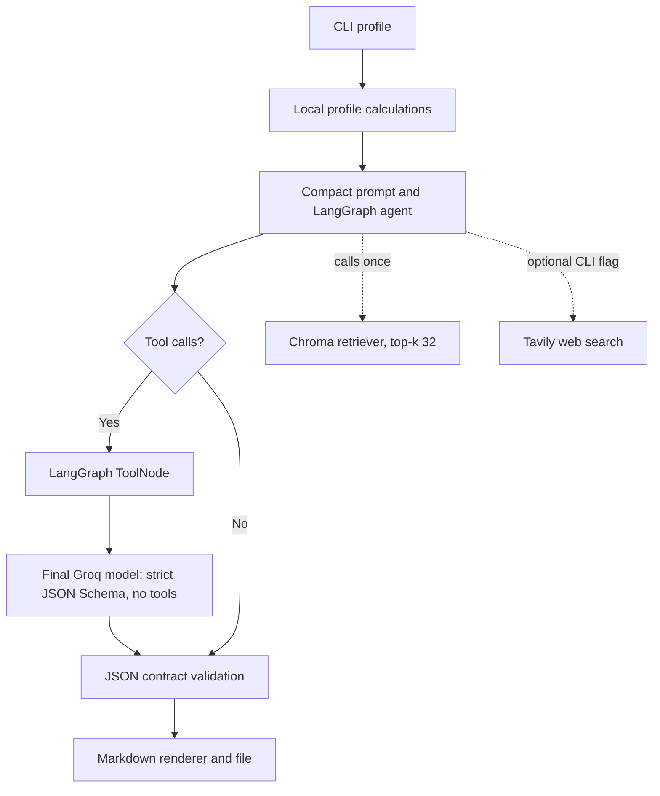

# Architecture

## Current structure

- `app/config/settings.py` reads model, Chroma, and API-key settings from the process environment without creating clients at import time.
- `app/tools/calculations.py` contains deterministic profile validation and metric calculations. It does not depend on LangChain.
- `app/agent/state.py` defines the message state and its append reducer.
- `app/agent/nodes.py` defines tool selection, final schema-constrained model invocation after RAG, and tool-call routing without importing LangGraph.
- `app/agent/graph.py` binds the tool-enabled model/tools and compiles the LangGraph flow with a separate no-tools final model.
- `app/agent/prompts.py` builds the three-week plan request from a validated profile.
- `app/agent/plan_output.py` defines the Groq strict JSON Schema, validates the response against the plan contract, and renders Markdown only after validation.
- `app/rag/embeddings.py` creates the Hugging Face embedding model on demand through the standalone `langchain-huggingface` integration.
- `app/rag/ingestion.py` reads the fitness knowledge text, splits it, creates stable chunk IDs, and upserts it into Chroma through `langchain-chroma`. It is a separate offline operation.
- `app/rag/retriever.py` checks that the persisted Chroma collection exists and contains records, then exposes a top-k retriever.
- `app/rag/citations.py` accepts source/evidence records only from internal RAG tool messages and builds the citation registry used to validate model-selected IDs.
- `app/tools/` contains lazy LangChain adapters for calculations, RAG, and optional Tavily search. The CLI calculates profile metrics locally; calculation is not an LLM tool in the default flow.
- `app/observability.py` emits JSON logs from an allowlist of fields and aggregates token metadata when returned by the provider; it does not estimate monetary cost.
- `app/runtime.py` composes the tool-enabled Groq model, a strict JSON Schema final Groq model, the required RAG tool, optional Tavily search, and graph after configuration validation.
- `app/main.py` provides the command-line entry point and writes the generated plan.
- `02_Agente_Treinador_Fitness.ipynb` is the only retained notebook; it delegates runtime construction and generation to the application modules.
- The Chroma collection is generated from `dados/conhecimento_fitness.txt` and is not stored in the repository. Docker Compose persists it in a named volume; local execution creates it under the configured persistence path.

## Validation and evaluation

The deterministic pytest suite covers calculation boundaries, settings, prompt/CLI behavior, graph routing, RAG contracts, citation membership, output validation, observability formatting, and tool adapter behavior with test doubles. It does not call paid or network services. These are software contract tests, not a measurement of generated-plan quality.

`app/rag/evaluation.py` runs a small, reviewed exact-evidence benchmark from `evaluation/retrieval_cases.json` and reports hit-rate@k, MRR, and mean retrieval latency. It is deterministic and framework-free. Exact snippet matching is a regression signal, not a semantic relevance or answer-faithfulness judgment. Generated answer faithfulness, sufficiency, and consistency still need a qualitative rubric or a separately calibrated evaluator. Model token usage/cost also requires provider response metadata and should be measured separately from correctness.

The observed five-query Docker baseline and measurement boundaries are recorded in [evaluation.md](evaluation.md). A qualitative plan review rubric is provided in `evaluation/plan_review_template.md`; those human judgments remain separate from deterministic tests.

The CLI writes one-line JSON logs with event name, end-to-end generation duration, session count, configured model, output path, and token counts when the provider returns usage metadata. It never logs prompts, user profile fields, retrieved passage contents, or credentials. Monetary cost is not estimated because pricing is provider/model/time dependent and not configured in this project.

## RAG ingestion flow

Run ingestion from the repository root with `python -m app.rag.ingestion`. Relative source and persistence paths resolve from the repository root, regardless of the current working directory. The default embedding model remains `all-MiniLM-L6-v2`.

## Agent query flow

The graph is built by `app/agent/graph.py`; the notebook invokes the compiled app. The flow uses the append-only message reducer and routes tool requests through LangGraph's `ToolNode`. Once the RAG tool result appears in state, the agent node switches from the tool-bound model to a no-tools model configured with Groq strict JSON Schema Structured Outputs and a 4096-token completion ceiling. The schema uses flat required session slots and reusable `$defs`/`$ref` definitions to require three weeks, the requested number of sessions per week, and three exercises per session without relying on array length constraints or repeating large schema fragments. `normalize_groq_plan` converts those slots to the list-based application contract and supplies the fixed weekly progression rules. Application validation enforces documented hypertrophy ranges, stable weekly sessions and prescriptions, unique training days, and the required Upper A/Lower A/Upper B/Lower B order and muscle region for four-day plans. Each exercise must cite a retrieved section whose heading exactly matches its knowledge-base name (or its equipment-free heading) and whose fields provide region, muscles, and execution cues. Rendering takes cues from `Dicas:` for a single execution guide and shows the matching reference section without repeating that cue. The default recursion limit is four graph steps, sufficient for one RAG call and a final response. An opt-in web search allows a larger bounded limit. When the RAG tool runs, the retriever embeds one query with the configured Hugging Face model, searches the existing Chroma collection, and returns up to 32 chunks so the local validator can use the whole small knowledge base without another search call. Exercise sections are ingested intact as individual documents. A missing or empty collection raises an explicit error instead of returning a tool result that resembles useful evidence.

The RAG adapter creates each citation ID as a SHA-256 prefix over the source path and retrieved section content and fails if source metadata is missing. Retrieved passages and optional web results are marked as untrusted reference data in the prompt; this is a prompt-level mitigation, not a complete injection defense. The command-line entry point accepts profile arguments, calculates reference metrics locally, builds the runtime from environment settings, invokes the graph, collects citation records from RAG tool messages, validates the strict JSON response in `app/agent/plan_output.py`, renders Markdown deterministically with exercise-linked source sections, and saves only a valid plan. Exercise and muscle-region matching is deterministic and based on section headings and documented muscle keywords; it does not prove general semantic entailment or medical suitability. Tavily is instantiated only when `--web-search` is passed. API clients are created only when the runtime is built, not when modules are imported.

## Current boundaries and limitations

- The standalone entry point is a command-line interface; no HTTP service is included.
- Retrieval scores are not exposed. Source-linked citations are rendered, but the system does not prove that each passage semantically entails the associated exercise claim.
- Existing chunks whose historical source metadata differs from `dados/conhecimento_fitness.txt` are not automatically removed by the new ingestion flow.
- Retrieval settings remain at the prototype values until the included benchmark has been run and its relevance limitations reviewed.

## Container setup

`Dockerfile` has a `test` build target that installs only pytest and runs the isolated test suite, plus a `runtime` target that installs the application dependencies. `compose.yaml` persists the Chroma database, Hugging Face model cache, and generated output in separate volumes/bind mounts. API credentials are passed through the local `.env` file and are excluded from the image build context.
