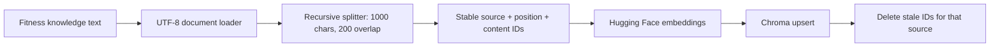
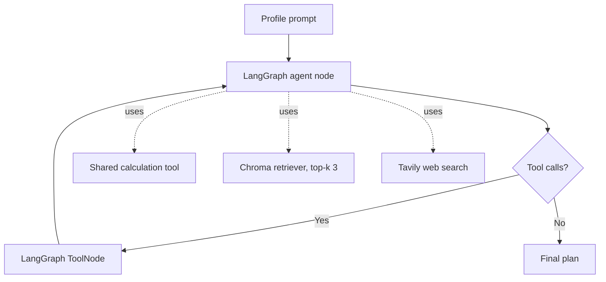

# Architecture

## Current structure

- `app/config/settings.py` reads model, Chroma, and API-key settings from the process environment without creating clients at import time.
- `app/tools/calculations.py` contains deterministic profile validation and metric calculations. It does not depend on LangChain.
- `app/agent/state.py` defines the message state and its append reducer.
- `app/agent/nodes.py` defines model invocation and tool-call routing without importing LangGraph.
- `app/agent/graph.py` binds the injected model/tools and compiles the LangGraph model/tool cycle.
- `app/agent/prompts.py` builds the three-week plan request from a validated profile.
- `app/rag/embeddings.py` creates the Hugging Face embedding model on demand through the standalone `langchain-huggingface` integration.
- `app/rag/ingestion.py` reads the fitness knowledge text, splits it, creates stable chunk IDs, and upserts it into Chroma through `langchain-chroma`. It is a separate offline operation.
- `app/rag/retriever.py` checks that the persisted Chroma collection exists and contains records, then exposes a top-k retriever.
- `app/tools/` contains lazy LangChain adapters for calculations, RAG, and Tavily.
- `app/runtime.py` composes the Groq model, tools, and graph after configuration validation.
- `app/main.py` provides the command-line entry point and writes the generated plan.
- `02_Agente_Treinador_Fitness.ipynb` remains an experimental entry point and delegates tool/runtime construction to the application modules.
- `ferramentas_ai.py` remains as a legacy compatibility module; the application runtime uses the adapters under `app/tools/`.

## Validation and evaluation

The deterministic pytest suite covers calculation boundaries, settings, prompt/CLI behavior, graph routing, RAG contracts, and tool adapter behavior with test doubles. It does not call paid or network services. These are software contract tests, not a measurement of generated-plan quality.

LLM quality evaluation remains a follow-up: retrieval relevance needs a small reviewed query/evidence set, and answer faithfulness, sufficiency, and consistency need a qualitative rubric or an explicitly calibrated evaluator. Latency and token/cost telemetry also require provider response metadata and should be measured separately from correctness. No evaluation framework is added until a concrete evaluation protocol justifies it.

## RAG ingestion flow

Run ingestion from the repository root with `python -m app.rag.ingestion`. Relative source and persistence paths resolve from the repository root, regardless of the current working directory. The default embedding model remains `all-MiniLM-L6-v2`.

## Agent query flow

The graph is built by `app/agent/graph.py`; the notebook invokes the compiled app. The flow uses the append-only message reducer, routes tool requests through LangGraph's `ToolNode`, and returns to the model after tool execution. The notebook sets a recursion limit of 12 graph steps so a tool loop terminates with a LangGraph limit error instead of running indefinitely. When the RAG tool runs, the retriever embeds the query with the configured Hugging Face model, searches the existing Chroma collection, and returns up to three relevant chunks to the model. A missing or empty collection raises an explicit error instead of returning a tool result that resembles useful evidence.

The command-line entry point accepts profile arguments, validates them with the deterministic calculation contract, builds the runtime from environment settings, invokes the graph, and saves the final Markdown response. API clients are created only when the runtime is built, not when modules are imported.

## Current boundaries and limitations

- The standalone entry point is a command-line interface; no HTTP service is included.
- The RAG pipeline does not yet expose scores or citations in the generated answer.
- Existing chunks whose historical source metadata differs from `dados/conhecimento_fitness.txt` are not automatically removed by the new ingestion flow.
- Retrieval settings remain at the prototype values pending a small, reviewed retrieval evaluation set.

## Container setup

`Dockerfile` has a `test` build target that installs only pytest and runs the isolated test suite, plus a `runtime` target that installs the application dependencies. `compose.yaml` persists the Chroma database, Hugging Face model cache, and generated output in separate volumes/bind mounts. API credentials are passed through the local `.env` file and are excluded from the image build context.
